> **Note:** This document was generated with the help of AI.

# How the Sejm chamber is drawn

`chamber-layout.ts` works out where each of the 465 seats in the Sejm plenary hall stands and which number it has.
This document walks through it step by step, in plain words, with pictures. Every picture was drawn with the same math the code uses.

## Table of contents

1. [What are we trying to do?](#1-what-are-we-trying-to-do)
2. [The map of the chamber: where is "zero"](#2-the-map-of-the-chamber-where-is-zero)
3. [Rows are arcs](#3-rows-are-arcs)
4. [Angles: left, top, right](#4-angles-left-top-right)
5. [Turning a length into an angle](#5-turning-a-length-into-an-angle)
6. [Placing seats on an arc](#6-placing-seats-on-an-arc)
7. [Seat blocks](#7-seat-blocks)
8. [The four sections of the chamber](#8-the-four-sections-of-the-chamber)
9. [Seats along the walls](#9-seats-along-the-walls)
10. [Numbering the seats](#10-numbering-the-seats)
11. [The bounding box and the screen](#11-the-bounding-box-and-the-screen)
12. [The whole chamber](#12-the-whole-chamber)

---

## 1. What are we trying to do?

In the Sejm, seats stand in a half circle around the rostrum, like the audience in an amphitheatre.
We want the computer to work out where to draw every seat by itself, instead of typing in 465 pairs of coordinates by hand.

The code does three things:

1. **Calculates the positions** of all seats (where to draw a dot).
2. **Gives them numbers** the same way the Chancellery of the Sejm does (for example seat 268).
3. **Measures how much space the whole chamber takes**, so it can be fitted to the screen.

> All settings of the chamber live in one `layout` object at the top of the file.
> To change something (for example the width of the aisle), you only change a number there.

```ts
const layout = {
  firstSeatNumber: 34,
  firstRowRadius: 70,
  distanceBetweenRows: 30.7,
  sectionCount: 4,
  seatsInFrontRows: [3, 5, 6],
  seatsInBackRows: [3, 4, 5, 5, 6, 7, 7, 7],
  wallColumn: { seatCount: 3, firstSeatOffset: 11.5, seatSpacing: 15.5 },
  sectionEdgeGap: 10,
  aisleWidth: 36,
  seatSize: 13.8,
  missingSeatNumbers: [61, 62, 63],
  renamedSeatNumbers: new Map([[285, 5]]),
};
```

## 2. The map of the chamber: where is "zero"

To say where a seat stands, we need a starting point, just like on a treasure map:
"from the old oak, 3 steps right and 5 steps up". Our "oak" is the point **(0, 0)**: the middle of the bottom line of the chamber, right next to the rostrum.

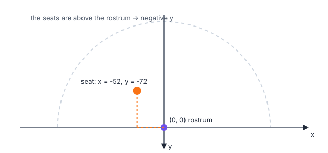

- **x** says how far to the right (plus) or to the left (minus).
- **y** says how far down. On computer screens y grows downwards, so the seats in the chamber (which are "above" the rostrum) have a **negative y**.
- The units are not pixels but "chamber steps". The component converts them to the size of the screen later.

## 3. Rows are arcs

Each row of seats is a piece of a circle whose center is at (0, 0).
The radius is the distance of the row from that center. The first row has a radius of 70, and every next row is 30.7 further away.

```ts
const getRowRadius = (row: number) =>
  layout.firstRowRadius + (row - 1) * layout.distanceBetweenRows;
```

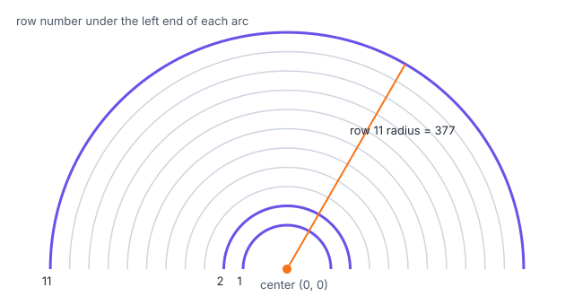

| Row | Calculation   | Radius |
| --- | ------------- | ------ |
| 1   | 70 + 0 × 30.7 | 70     |
| 2   | 70 + 1 × 30.7 | 100.7  |
| 5   | 70 + 4 × 30.7 | 192.8  |
| 11  | 70 + 10 × 30.7 | 377   |

There are 11 rows: 3 front rows (`seatsInFrontRows`) and 8 back rows (`seatsInBackRows`).

## 4. Angles: left, top, right

Once we know which row (which arc) a seat is in, we still have to say **where on that arc** it is.
That is what an angle is for, like a clock hand pinned at the point (0, 0).

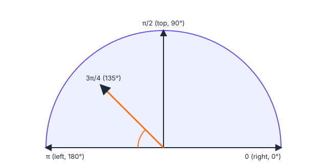

- The angle **π** (say "pi", about 3.14) is the **left** end of the half circle.
- The angle **π/2** is the **middle at the top**.
- The angle **0** is the **right** end.

> Programmers measure angles in **radians**, not degrees. The whole half circle is π radians, which is 180°.
> A quarter of the half circle (45°) is π/4.

## 5. Turning a length into an angle

```ts
const lengthToAngleInRow = (length: number, row: number) => length / getRowRadius(row);
```

An aisle between seats should have **the same width in every row**, for example 18 steps.
But the same piece of distance on a small arc and on a big arc means different angles.
Think of a pizza: a 2 cm wide piece at the edge of a big pizza is a thin little triangle, while the same piece of a small pizza is a fat triangle.

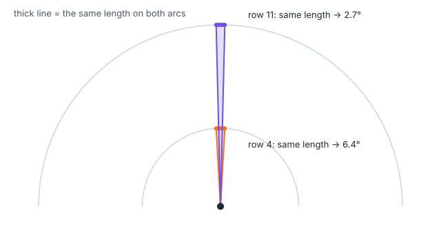

The formula is simple: **angle = length ÷ radius**.

| Row | Radius | 18 steps is an angle of…        |
| --- | ------ | ------------------------------- |
| 4   | 162.1  | 18 ÷ 162.1 ≈ 0.111 rad ≈ 6.4°   |
| 11  | 377    | 18 ÷ 377 ≈ 0.048 rad ≈ 2.7°     |

Thanks to this, the aisle is equally wide along its whole length, just like the real stairs in the chamber.

## 6. Placing seats on an arc

```ts
const placeSeatsEvenlyOnArc = (options: {
  row: number;
  seatCount: number;
  startAngle: number;
  endAngle: number;
}) => {
  const radius = getRowRadius(options.row);
  const arc = new EllipseCurve(0, 0, radius, radius, options.startAngle, options.endAngle, true);

  return Array.from({ length: options.seatCount }, (_, seatIndex) => {
    const point = arc.getPointAt(seatIndex / Math.max(options.seatCount - 1, 1));

    return { x: point.x, y: -point.y };
  });
};
```

This function gets: **a row**, **how many seats**, **a start angle** and **an end angle**. Then it does three things:

1. **Draws an arc.** `EllipseCurve` from the three.js library is a "path" shaped like an arc. A circle is an ellipse whose two radii are equal.
2. **Picks evenly spaced spots on the arc.** `getPointAt(t)` returns a point on the path: t = 0 is the start, t = 1 is the end, t = 0.5 is halfway. For 5 seats we use t = 0, 0.25, 0.5, 0.75 and 1.
3. **Flips y.** In math y grows upwards, on screens it grows downwards, hence `-point.y`.

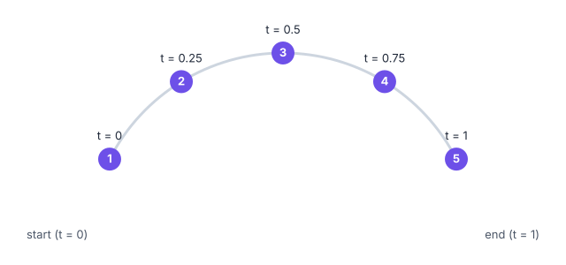

> `Math.max(seatCount - 1, 1)` is a safety net: if a row had only one seat, we would not divide by zero.

## 7. Seat blocks

```ts
const createSeatBlock = ({ endEdge, firstRow, seatsPerRow, startEdge }: {
  firstRow: number;
  seatsPerRow: number[];
  startEdge: Edge;
  endEdge: Edge;
}) =>
  seatsPerRow.flatMap((seatCount, rowIndex) => {
    const row = firstRow + rowIndex;

    return placeSeatsEvenlyOnArc({
      row,
      seatCount,
      startAngle: startEdge.angle - lengthToAngleInRow(startEdge.gap, row),
      endAngle: endEdge.angle + lengthToAngleInRow(endEdge.gap, row),
    });
  });
```

A **block** is a group of seats bounded on the left and on the right by an **edge** (a line going out from the center of the chamber).
Each edge has two numbers:

- `angle`: where the edge line runs,
- `gap`: how many steps to move the first seat away from that line (so seats do not stand on the stairs).

For every row of the block we work out where its piece of the arc starts and ends (the edge plus the gap, turned into an angle), and place the seats there with the function from step 6.
`seatsPerRow: [3, 5, 6]` means: 3 seats in the first row of the block, 5 in the second and 6 in the third.

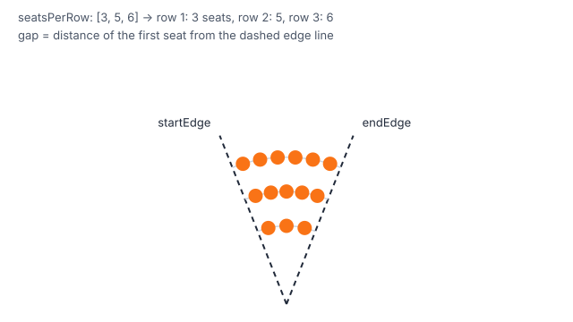

## 8. The four sections of the chamber

```ts
const createSectionSeats = (sectionIndex: number) => {
  const sectionAngle = Math.PI / layout.sectionCount; // 180° / 4 = 45°
  const startAngle = Math.PI - sectionIndex * sectionAngle; // left edge of the section
  const middleAngle = startAngle - sectionAngle / 2; // middle (the aisle)
  const endAngle = startAngle - sectionAngle; // right edge of the section
  // …
};
```

We cut the half circle like a cake into **4 equal slices of 45°**. Each section is made of three blocks:

| Block                 | Rows | Seats in the rows      | From edge… to edge                        |
| --------------------- | ---- | ---------------------- | ----------------------------------------- |
| 🟠 front block        | 1–3  | 3, 5, 6                | left section edge → right section edge    |
| 🟣 left wedge         | 4–11 | 3, 4, 5, 5, 6, 7, 7, 7 | left section edge → the aisle in the middle |
| 🟢 right wedge        | 4–11 | 3, 4, 5, 5, 6, 7, 7, 7 | the aisle in the middle → right section edge |

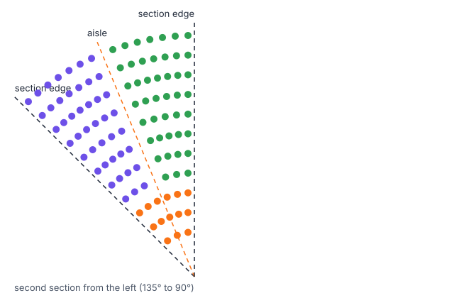

Section edges have a gap of `sectionEdgeGap` (10 steps), and the aisle in the middle is `aisleWidth` wide (36 steps),
so each wedge moves away from it by half of that: 18 steps.

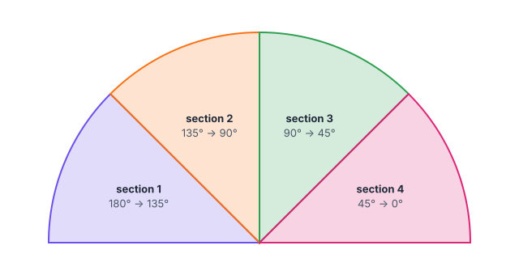

## 9. Seats along the walls

```ts
const createWallSeats = (side: 'left' | 'right') => {
  const rowsAlongWall = Array.from({ length: rowCount - 1 }, (_, index) => index + 2);
  const { seatCount, firstSeatOffset, seatSpacing } = layout.wallColumn;

  return rowsAlongWall.flatMap((row) => {
    const x = side === 'left' ? -getRowRadius(row) : getRowRadius(row);

    const column = Array.from({ length: seatCount }, (_, seatIndex) => ({
      x,
      y: firstSeatOffset + seatIndex * seatSpacing,
    }));

    return side === 'left' ? column.toReversed() : column;
  });
};
```

At the bottom, along both walls, rows do not end on the arc. They go on **straight down**:
every row from the 2nd to the 11th has 3 extra seats there, one below the other.

- The x of such a seat is the radius of its row (minus on the left side, plus on the right side).
- The y is 11.5 steps below the rostrum line, then every 15.5 steps comes the next seat.

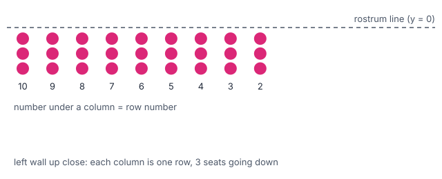

> On the left side a column is counted **from the bottom up** (`toReversed()`), and on the right side **from the top down**.
> This way the numbering runs in one go around the whole chamber, clockwise.

## 10. Numbering the seats

```ts
// Seats are numbered clockwise around the chamber: left wall, sections from the left, right wall.
const positionsInNumberingOrder = [
  ...createWallSeats('left'),
  ...Array.from({ length: layout.sectionCount }, (_, index) => createSectionSeats(index)).flat(),
  ...createWallSeats('right'),
];

const seats = positionsInNumberingOrder
  .map((position, index) => ({ id: layout.firstSeatNumber + index, position }))
  .filter((seat) => !layout.missingSeatNumbers.includes(seat.id))
  .map((seat) => ({ ...seat, id: layout.renamedSeatNumbers.get(seat.id) ?? seat.id }));
```

The Chancellery of the Sejm numbers seats in one order, around the chamber:

1. the left wall (from the rostrum towards the wall),
2. the sections from left to right (in each one: the front block, the left wedge, the right wedge, row by row),
3. the right wall.

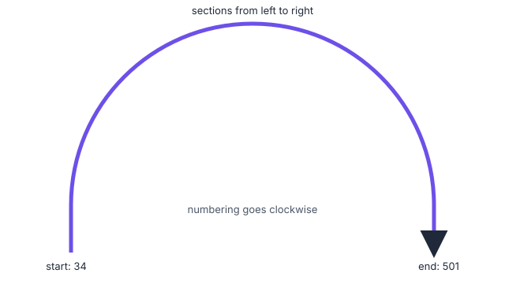

Then we number in three steps:

| Step      | What happens                                                    | Example                              |
| --------- | --------------------------------------------------------------- | ------------------------------------ |
| `.map`    | Each next seat gets the next number, starting from 34.          | 1st seat → 34, 2nd → 35…             |
| `.filter` | We drop the numbers of seats that do not exist in the chamber.  | 61, 62, 63 (left wall in row 11)     |
| `.map`    | We change the number of one seat that has a different number in the Sejm. | 285 → 5                    |

> Finally `new Map(…)` works like a phone book: you give it a seat number (for example 268)
> and instantly get its position, without searching through the whole list.

## 11. The bounding box and the screen

```ts
const getBoundingBox = (points: { x: number; y: number }[], padding: number) => {
  const xs = points.map((point) => point.x);
  const ys = points.map((point) => point.y);
  const left = Math.min(...xs) - padding;
  const top = Math.min(...ys) - padding;

  return {
    left,
    top,
    width: Math.max(...xs) + padding - left,
    height: Math.max(...ys) + padding - top,
  };
};
```

The last step: we check which seat is furthest to the left, to the right, at the top and at the bottom.
These four numbers form a **rectangle** that contains the whole chamber.
We add a small margin around it (`seatSize`) so the outermost circles are not cut off.

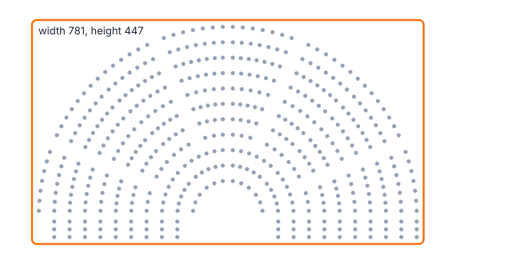

The `ParliamentChamber` component turns this rectangle into a box with the same proportions, and places every seat in **percentages** of that box:

```text
left = (seat x - left edge of the rectangle) / width of the rectangle × 100%
top  = (seat y - top edge of the rectangle)  / height of the rectangle × 100%
```

For example, a seat in the middle of the chamber's width gets `left: 50%`.
On a phone and on a big monitor it always stands in the same spot of the chamber; the whole chamber simply shrinks or grows.

## 12. The whole chamber

Everything together: 465 seats, numbered from 34 to 501, without 61–63, where seat 285 has the number 5.

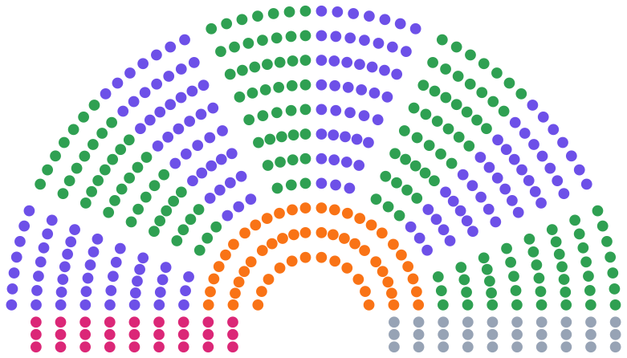

| Color      | Part of the chamber |
| ---------- | ------------------- |
|  pink | left wall |
| 🟠 orange  | front blocks        |
| 🟣 purple  | left wedges         |
| 🟢 green   | right wedges        |
| ⚪ gray    | right wall          |
